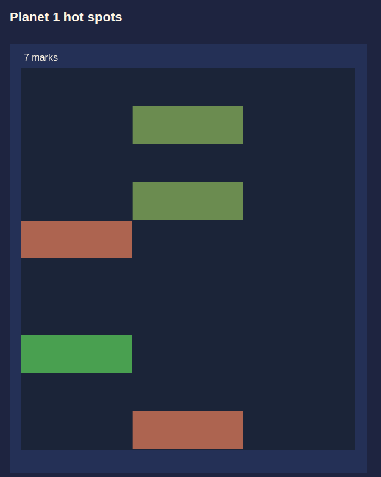
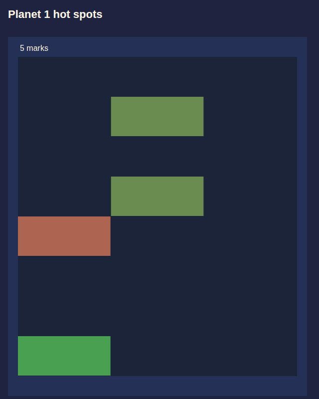

# Space Buddies bugs

Severities: P0 crash or softlock, P1 breaks a round, P2 feel, P3 cosmetic. Seeds are the `?seed=` value. Shots are 390×844.

## SB-1 Seated badge said 16TH

- Severity: P2
- Status: fixed
- Seed: 4
- Shot: `qa/shots/sb-spectate-before.png`

Repro: finish a seat (or board on seed 4), look at the place shield. It counted every racer ahead of your parked body, so seat 1 of 8 read 16TH.

Fix: a seated player shows `SEAT n` from boarding order. Regression in `src/qa-regress.test.js`.

## SB-2 Spectate sat low, close, and foggy

- Severity: P2
- Status: fixed
- Seed: 4
- Shot: `qa/shots/sb-spectate-before.png`, after `qa/shots/sb-spectate-after.png`

Repro: take a seat on the meadow and wait out the boarding cinematic. The orbit was about 12 m back but only 5 m up, looked at the leader's chest, and left the meadow fog on, so Buddies crowded the bottom of the frame.

Fix: the orbit stays 13 m out and 11 m up, looks 9 m ahead along the course, and pushes the fog out to 150 m. A Buddy standing under the camera lifts the frame. Regression checks the 10–14 m band, the height, and the look-ahead.

## SB-3 Body falls through a floor a ramp overlaps

- Severity: P1
- Status: fixed
- Seed: 4, and harness seed 213 before the fix (planet 1 round 1)

Repro: stand on the lower pad where a higher bridge ellipse covers the same ground, around quick-mode `(1.2, 112)`. The ground query returned only the higher pad. That pad was too tall to step onto, so the lower floor was ignored and the body dropped through it.

Fix: walking considers every floor under the point and stands on the highest one the step can actually reach. Regression drops the player through that overlap and expects them to land.

## SB-4 Jump controls come back during the launch

- Severity: P1
- Status: fixed
- Seed: 213 (planet 1, ship round)

Repro: board the ship and let the round end. The thumb buttons were hidden while you waited, then shown again for the launch because only the results screen hid them.

Fix: controls stay hidden for countdown, launch, results, and any moment you are seated. Regression covers those four cases.

## Harness

`npm run test:qa` plays quick rounds in headless Chrome. Phone runs are 390×844, touch, device pixel ratio 3. Landscape runs are 1280×800. Twenty seeds per planet cover the three round types. Adversarial passes hug the wall, jump off the edge, stand still, spam jump and dive, reverse, pinch, pause, background the tab, and rotate the phone. The script also walks title, locker, spectate, podium, map, and a five-round memory check.

Before these fixes, a planet 1 smoke (gate, sky heat, ship) failed 2 of 3 runs: the body fell through an overlapped floor, and the launch showed the jump controls. After the fixes, 20 seeds on each planet (60 rounds, every round type) passed with no P0, P1, or P2. The menu flow, adversarial passes, and the five-round memory check then passed 21 of 21. Combined pass rate: 81 of 81.

Headless Chrome on this machine renders with a software GPU, so frames under 45 are recorded as P3 environment notes and are not counted as phone defects. Logic runs use `?qa=4` so the sim can finish a quick round without changing the step size. The realtime pause, pinch, background, and rotate checks use `qa=1`.

## SB-5 A fast fall skips the floor

- Severity: P1
- Status: fixed
- Seed: 4, and batch 2 seeds 314, 327, 320 before the fix

Repro: dive or drop faster than one step can sample. The floor test rejected the pad once the body was already more than 0.42 m below it, so the landing never happened. Batch 2 counted 20 missed landings across 15 feel runs.

Fix: the landing test uses the top and bottom of the step, so a single 1/60 step cannot jump the floor. Regression drops the player at 24 m/s and expects them on the pad. After the fix those 15 runs recorded 0 missed landings. Falls off the edge of a pad still respawn and show up on the heatmaps.

## SB-6 Jump pressed during a dive never happens

- Severity: P2
- Status: fixed
- Seed: 4

Repro: tap jump while a ground dive is sliding. The slide lasts longer than the jump buffer, so the press expires before the body can leave the ground.

Fix: a jump pressed in the same step as the dive is remembered until the slide ends. Regression steps both inputs and expects the jump.

## SB-7 Pressed buttons and confetti keep listeners

- Severity: P2
- Status: fixed

Repro: play 10 rounds without a reload. Each results celebration added an animation listener that was never removed, and each press added pointer listeners that stayed if the pointer never came up. The 10-round session grew by 268 listeners.

Fix: confetti removes its own listener, and the press highlight uses one-shot pointer listeners. The same 10-round session then stayed flat.

## SB-8 The next obstacle sits outside the phone frame

- Severity: P2
- Status: fixed
- Seed: 320 (planet 1, round 1)

Repro: on a 390-wide screen the follow camera looked at the Buddy's shoulders, so hazards on the racing line were above or beside the frame. The first batch counted 139 off-screen obstacles across 15 runs.

Fix: the follow camera sits higher (5.1 m portrait, 5.3 m landscape) and looks 5 m down the line. The same runs then counted 14.

## SB-10 Survival falls respawn instead of eliminating

- Severity: P1
- Status: fixed
- Seed: 4, planet 3

Repro: in a survival round, drop the player about 20 m. The body came back to a floor, `eliminated` stayed false, and all 16 racers stayed in the round.

Fix: a void, lava, or long air-stuck fall in survival marks that racer out and the round ends when 8 remain. The result card lists who fell. Other round types still respawn.

## SB-11 The follow camera follows a long fall under the floor

- Severity: P1
- Status: fixed

Repro: force a long drop. The camera used the falling body as the floor once the pad query came back empty, so it sat near y -6 and clipped a slab.

Fix: the camera keeps the last real floor and stays at least 1 m above it.

## SB-12 HUD clock, planet, seats, and rank

- Severity: P1
- Status: fixed

Repro: gate rounds showed SEATS 0/8 the whole heat. The result card counted the elapsed time up from zero, so a photo could read TIME 0:51 while the HUD countdown still said 2:10. The rank badge flipped every time two racers crossed.

Fix: gate and crown rounds show QUAL n/target, survival shows ALIVE n/16, and only the ship round says SEATS. The result card writes the final elapsed time and the time left immediately, plus the planet number. The rank badge waits 0.4 s before it changes.

## SB-13 Pause buttons and the coach tip

- Severity: P1
- Status: fixed

Repro: pause actions were about 22 px tall. The meadow tip sat on top of DIVE and GRAB. Mute and pause were 40 px.

Fix: pause uses kit buttons at least 64 px tall. The tip sits under the top HUD. Jump is 128×132, Dive and Grab are 92×96, and mute and pause are 48 px, with the kit safe-area insets.

## SB-14 Giant mushroom ink hull

- Severity: P2
- Status: fixed

Repro: the meadow landmark mushroom, scaled up several times, wore a 4.5% backface hull. On a low-poly cap that reads as a jagged offset black edge.

Fix: the landmark no longer gets an ink hull. Buddy and ship hulls stay.

## SB-15 Title screen returned mid-session

- Severity: P2
- Status: explained

A 2026-11-24 playtest returned to the title twice. This cycle did not reproduce a client reset across full rounds, pause, and restarts. PR 136 merged during that playtest and GitHub Pages republished the live build a few seconds later. A reload of the page is the likely cause. No further code change.

## SB-16 Floors still read as flat grey discs

- Severity: P2
- Status: fixed

The meadow, canyon, and sky floors were thin discs. Downward normals and a two-color checker made them read as flat grey.

Fix: each pad is a slab with a 2-segment bevel (about 9 cm) and a cream lip on the top 8 cm of the side. The top uses the zone ground color with a soft speckle, and the side uses the ground side color. The walk height is unchanged. No extra shadow map.

The first lip was hard to see from the follow camera, so the cream band is now about 28 cm tall and also rings the top edge. A prop that blocks the Buddy pulls the camera in or fades, instead of filling the lens.

## SB-17 Mute icon, music, and settings

- Severity: P1
- Status: fixed

Repro: at race start the mute icon was a speaker with an X while audio was playing. Title and locker had no music or SFX split, and iOS would not start sound until a gesture resumed the audio context.

Fix: the icon is a plain speaker while anything is audible and a speaker with an X when the output is silent. The choice is saved on the phone. Title, locker, and pause open a SOUND panel with music, SFX, haptics, and mute. The first tap resumes Howler. `music_race_loop` loops during a race. Jump, land, dive, hit, collect, qualify, the 3-2-1-GO count, the ship launch, and menu tap, back, and confirm play the CC0 pack, preferring the `_v2` files.

## SB-18 Pause label wraps and the coach tip stays up

- Severity: P2
- Status: fixed

Repro: on the pause card, MAIN MENU broke onto two lines. The yellow coach tip stayed on screen over the paused race.

Fix: the pause buttons stay on one line. The coach tip hides while the pause menu is open.

## SB-9 Obstacles hit with under half a second of warning

- Severity: P2
- Status: fixed
- Seed: batch 2 feel seeds, previously 6 unfair hits

Repro: a bumper, spinner, sweeper, pendulum, roller, or hopper could connect in the same moment it entered range. The feel harness counted that as an unfair hit.

Fix: each of those hazards shows a ground ring and holds the hit until it has been armed for 0.55 s. Buddy-to-buddy bumps are not scored as obstacle hits. The batch 2 harness then reported 0 unfair hits.

## SB-19 Rounds shared one timer, one hazard set, and one bot pace

- Severity: P1
- Status: fixed

Repro: every heat used the full-course 180 second clock, so a short gate never felt the collapse. Bots held a fixed speed order and never aimed at the crown, the ship, or the gate. Decor on the pads used the same loud colors as the hazards, and planets 2 and 3 only changed the sky.

Fix: each plan entry has its own seconds, and the collapse front starts just behind that start and arrives at the gate near the end of the clock. Trailing bots speed up a little and leaders ease off, never above the top bot cap. Bots steer to the crown, the ship, or a nearby gate, sidestep pendulums, and dive on flat runs. Bumpers and sweepers stay on planet 1, with a dark outline. Planet 2 pushes the wind, ferries, and rollers. Planet 3 speeds the collapse and the ice cracks, and swings the pendulums wider. Course trim sits outside the pad and stays muted.

## SB-20 Rounds open on the same camera

- Severity: P2
- Status: fixed

Repro: every planet dropped the Buddy into the countdown with the same short camera settle. The ship launch was a 1 second rise, and the next round cut straight to the start line.

Fix: each planet opens with a flyover that ends behind the Buddy. The ship launch shows the qualified Buddies running aboard, then lifts off. The next round and the next planet play a short collapse of the course you just left. Each shot is under 4 seconds and a tap skips it. Auto, bot, and harness runs skip the shots so the race clock stays put.

## Batch 2

`npm run test:qa2` adds feel totals, a per-planet heatmap, a 4x CPU throttle with the low-GPU profile, touch edges (multi-touch, a stick dragged off screen, jump during dive, pinch while moving, address bar show and hide), a 10-round session, and the eliminated path through the podium on every planet.

Before the fixes above, that pass failed 10 of 20 runs (pass rate 0.50). Missed landings 20, off-screen obstacles 139, snags 0, camera clips 0, unfair hits 6.

After: 20 of 20 passed. Missed landings 0, off-screen obstacles 14, snags 0, camera clips 0, unfair hits 6. Under 4x CPU the longest frame was about 2.7 s and the sim still took at most 6 steps of 1/60. Nothing tunneled. The fixed step held.

Heatmaps, before and after:

