# Content Hub UI review

Rubric, 1–10. The user is on a phone, about to film. A score of 8 means they can do that part of the job without hunting.

| Criterion | Question |
|---|---|
| Glanceability on phone | On a 390px screen, can you tell which script this is and what you say without scrolling through chrome? |
| Filming clarity | Are the reference, both hooks, the script or question sheet, setup, shot list, on-screen text, and CTA each obvious? |
| Hierarchy | Is there one thing to read first, or do equal-weight boxes compete? |
| Branding | Does it look like signals.marketing (Geist, ink, signal red, waveform, sharp red-top cards)? |
| Navigation | Can you tell whose scripts you are in, and move between clients, All, and a script, without getting lost? The default list filter stays All. |

Screenshots for the baseline were taken at 390×844 and 1280×800 against real script rows (Cristian question sheet, Jan talking-head, Andrew takes), rendered locally with auth bypassed only on localhost.

## Baseline — current UI, before the redesign

| Criterion | Score | Why |
|---|---|---|
| Glanceability on phone | 3 | Sticky chrome (client pills, List/Calendar/Pipeline, Filters, status pills, search) eats the first screen. The script itself is below a reference URL, proof stats, and a setup paragraph. Andrew’s filming notes are 11px in a 2-column grid. |
| Filming clarity | 4 | The dossier order is thoughtful, and “what you’re actually filming” exists, but proven vs. adapted hooks are one blob, the shot list is a sentence, on-screen text is buried in editor notes, the CTA is a tiny “Comment Follow” pill, and there is no teleprompter. Reference is a raw URL, not a thumbnail. |
| Hierarchy | 4 | Format pills, status pills, date chips, and blue/green/violet boxes have similar visual weight. The hook is not consistently the largest type. |
| Branding | 2 | “Content Hub,” slate background, near-black pills, blue focus rings, heavy rounding. No waveform, no Geist, no signal red. It does not look like signals.marketing. |
| Navigation | 5 | Admin client pills work, and All is the default filter, but on a phone Devin and Sagun sit off-screen in a row of identical pills. Status, mode, view, and client controls use the same pill shape, so none of them reads as the wayfinding. |

Baseline average: 3.6. Not shippable for someone filming from the phone.

## Iteration 1

First shot-card build. Screenshots at 390×844 and 1280×800, filters forced open, real script rows.

| Criterion | Score | Why |
|---|---|---|
| Glanceability on phone | 5 | The wordmark, client tabs, and status rail are clear, but the adapted line still sits under the reference player. The batch line is forced into small caps, and the date control is a large empty box. |
| Filming clarity | 6 | Reference, proven hook, question sheet, checklist, and full-screen read all render. Location parsed as “Not specified” because `LOCATION:` sits mid-paragraph. On a desktop width the script column dropped below the reference, leaving a blank left side. |
| Hierarchy | 6 | Title and status are strong. The all-caps kicker and the empty desktop column compete with them. |
| Branding | 8 | Waveform, Geist, signal red `#ce2029`, ink, paper, and the red top rule match signals.marketing. Login does too. |
| Navigation | 8 | All five client tabs fit on a 390px screen with a red underline. The client’s name sits under the wordmark. All stays the selected filter. |

What changed after this pass: lead with the line you say, parse inline `LOCATION:` / phone sentences, stop uppercasing the batch, shrink the date chip, and pin both desktop columns to the same grid row.

## Iteration 2

Same viewports, admin filters in their real default (collapsed), after the fixes above. Checked by reading the rendered card text and by driving the page: Sagun’s empty state, Calendar, Pipeline, a shot checkbox (count went to “1 of 4”), and the teleprompter (Play switches to Pause, Escape closes it).

| Criterion | Score | Why |
|---|---|---|
| Glanceability on phone | 8 | On 390px the title, the Draft / Filmed / Posted rail, and the adapted line are on the first screen. Format and batch are readable sentence case, not a caps wall. |
| Filming clarity | 8 | Reference is a play row plus Open. Proven hook and your line are separate. Question sheets are numbered; prose scripts are ~22px. Setup is four tiles (Fairmont hallways, handheld, 9:16 tripod, clip mic on the Cristian card; eye-height phone, chest-up, lav on Jan’s). Shot list is a checklist when the script has one. On-screen text is timed lines. CTA is its own block. Full screen is a dark teleprompter with a red focus line, type size, speed, and mirror. |
| Hierarchy | 8 | One large line, red mono eyebrows, a black active status chip. The reference is a dark bar, not another pastel card of equal weight. |
| Branding | 8 | signals.marketing lockup, Geist, `#ce2029` on `#fafafa` / `#171717`, sharp cards with a 2px red top rule. Filter chips still use the older pill shape; they are small enough that the page still reads as the brand. |
| Navigation | 9 | Andrew, Jan, Cristian, Devin, and Sagun are all visible. The active tab has a red underline and the full name is under the wordmark. The list filter still defaults to All. List, Calendar, and Pipeline still switch. |

Every criterion is at least 8. No third visual pass.

Notes that are not score bugs:

- The middle status chip reads **Filmed** when the saved status is **Filming**, which is the word already in the pipeline. The exact saved word (Draft, Needs Review, Approved, Filming, Posted, Passed, Archived) is printed above the chips and again under All fields.
- A client who still has scripts in Needs Review is still dropped on that queue at sign-in. That behavior was already there. The filter’s default, and the admin sign-in default, stay All.
- Scripts with no `SHOT LIST:` line do not invent shots. Reaction scripts get the four-step filming order. Everything else leaves the checklist off and keeps the setup paragraph.

## Thumbnails, script type, and responsive layout

The card now shows the reference cover, and the list can separate Interview from B-roll. Format letters A–F are Interview and G–J are B-roll. A trailing digit (`F1`, `F14`, `J1`, `J11`) stays Other, as does anything outside A–J (Cristian’s K, L, and M). The default type is All, so unlettered scripts stay visible. When All contains more than one of those groups, the list splits under Interview, B-roll, and Other. The type bar only appears when the current status filter actually contains an interview or a B-roll.

The cover comes from `thumbnail_url` when that column is set. If it is empty, a YouTube reference uses `i.ytimg.com`; other hosts fall back through oEmbed and og:image, then the waveform poster. The column is nullable and the existing row policies cover it (`migrations/2026-10-22_scripts_thumbnail_url.sql`). Signed Instagram and TikTok URLs expire, so a failed image tries the remote fallback once and then returns to the waveform.

On a phone the cover is the full width of the card, under the line you say. In the list it is a small frame beside the title. From 768px up the card is two columns: the line, question sheet, and CTA on the left, the cover on the right. Both columns share the first grid row. The shell grows from a 960px cap toward 1280px (`clamp(960px, 86vw, 1280px)`), so a 1920px window does not stretch a script line across the monitor. Script text still stops at 40rem.

Controls that are tapped while filming are at least 44px tall (client tabs, List / Calendar / Pipeline, the type bar, status chips, icon and Sign out, Open, the status rail). The date chip stays visually short; its invisible input is 44px tall. Header padding uses the top safe-area inset. Header and page padding use the left and right insets, and the page bottom padding includes the home-indicator inset. Nothing uses `100vw`, which was pushing the settings panel past the screen.

Checked in Chrome at each width below. `documentElement.scrollWidth` matched `clientWidth` at every one (overflow 0). Phones are one column. 768, 1024, 1280, 1440, and 1920 are two columns, and the cover’s width matched its column. With a simulated iPhone notch (top 47, bottom 34) the header’s top padding became 47px and the page bottom padding became 74px. In landscape (left and right 47, bottom 21) those paddings became 47px and 61px, the wordmark stayed intact, and overflow stayed 0. The settings panel on a 360px screen sat inside the viewport (288px wide, 16px from the right edge) and its close control was 44px. Calendar and Pipeline were checked at 360 and 768; the month title, 7-column grid, and stage list did not spill.

The frames in these shots are stand-in covers. The signed Instagram CDN URLs 403 from this network, so the harness used YouTube `hqdefault` images. Width and crop were measured on those images. Live cards use `thumbnail_url`.

| Criterion | Score | Why |
|---|---|---|
| Glanceability on phone | 8 | At 390px the title, Draft / Filmed / Posted, and the line you say are on the first screen. The cover starts under that line, not above it. |
| Filming clarity | 9 | The reference is a full-width cover with Play and Open, not a URL. Interview and B-roll are separate. Question sheet, setup, checklist, on-screen text, CTA, and the teleprompter are unchanged. |
| Hierarchy | 8 | One large line, then the cover. B-roll cards use an ink top rule instead of signal red. |
| Branding | 8 | Same lockup, Geist, and signal red. The shell stays a readable column on a large monitor. |
| Navigation | 9 | Client tabs, All, and the type bar (All / Interview / B-roll) fit on a 360px screen. The list filter still defaults to All. |

### 360px

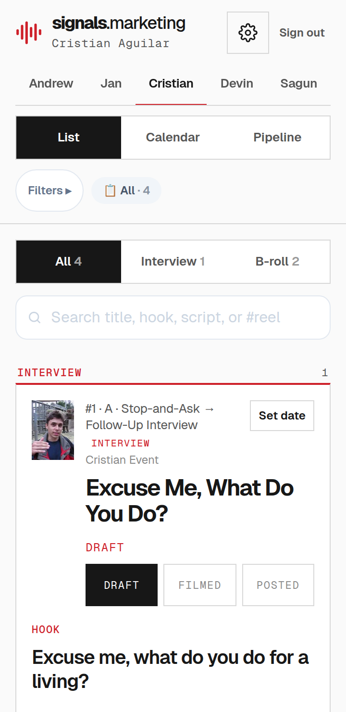

### 390px

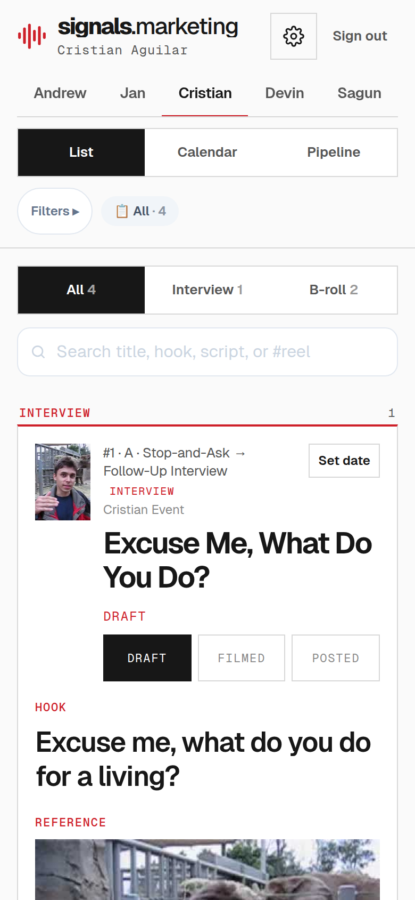

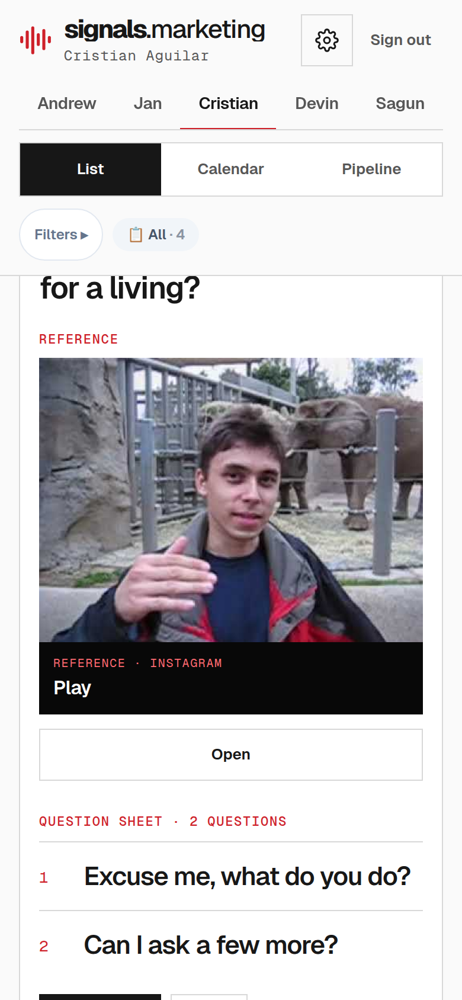

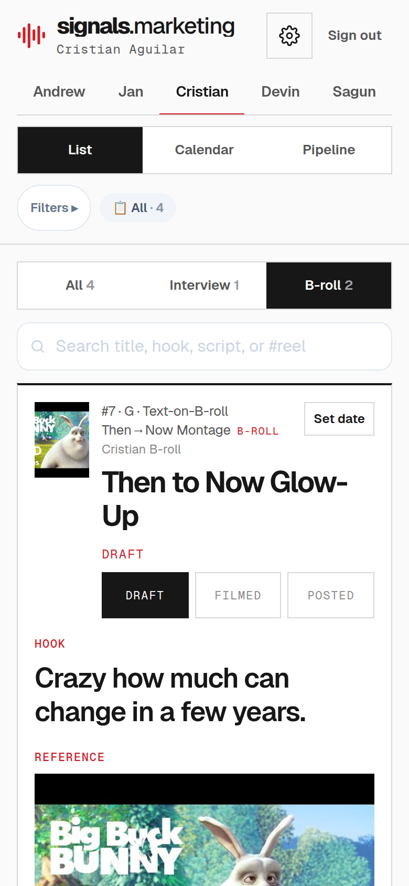

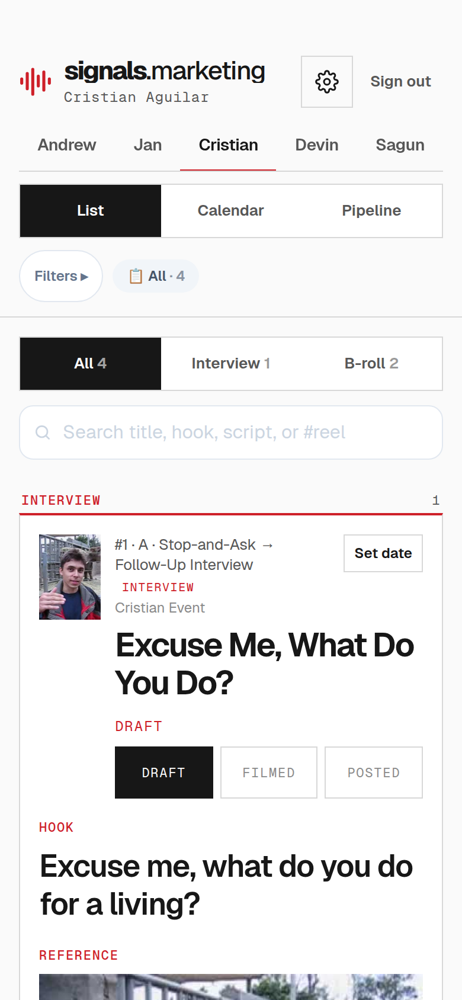

### 430px

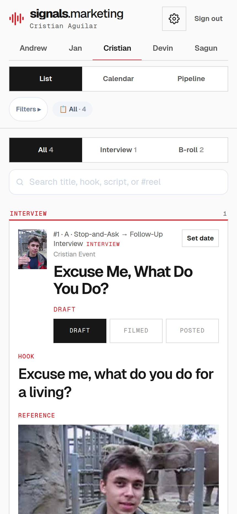

### 768px tablet portrait

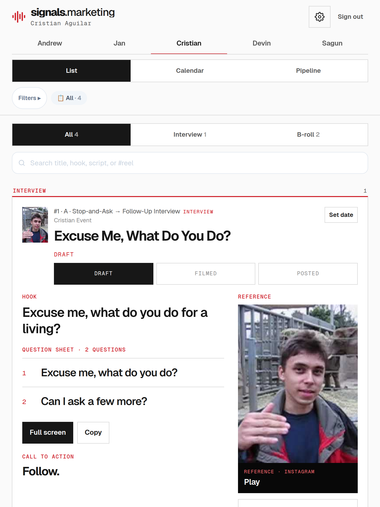

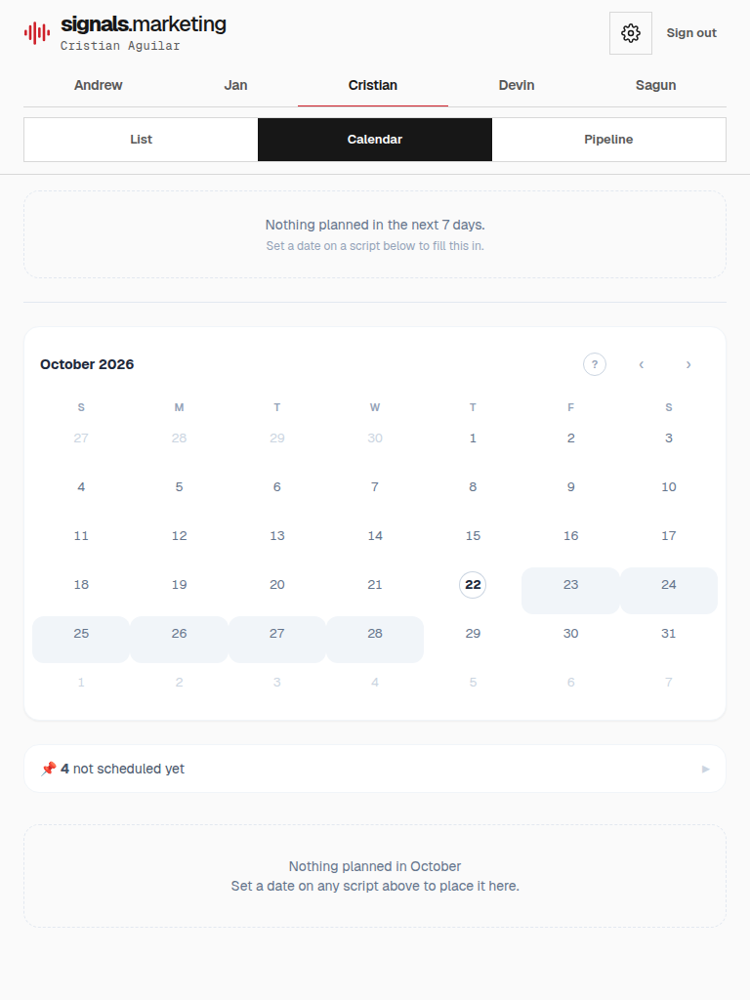

### 1024px tablet landscape

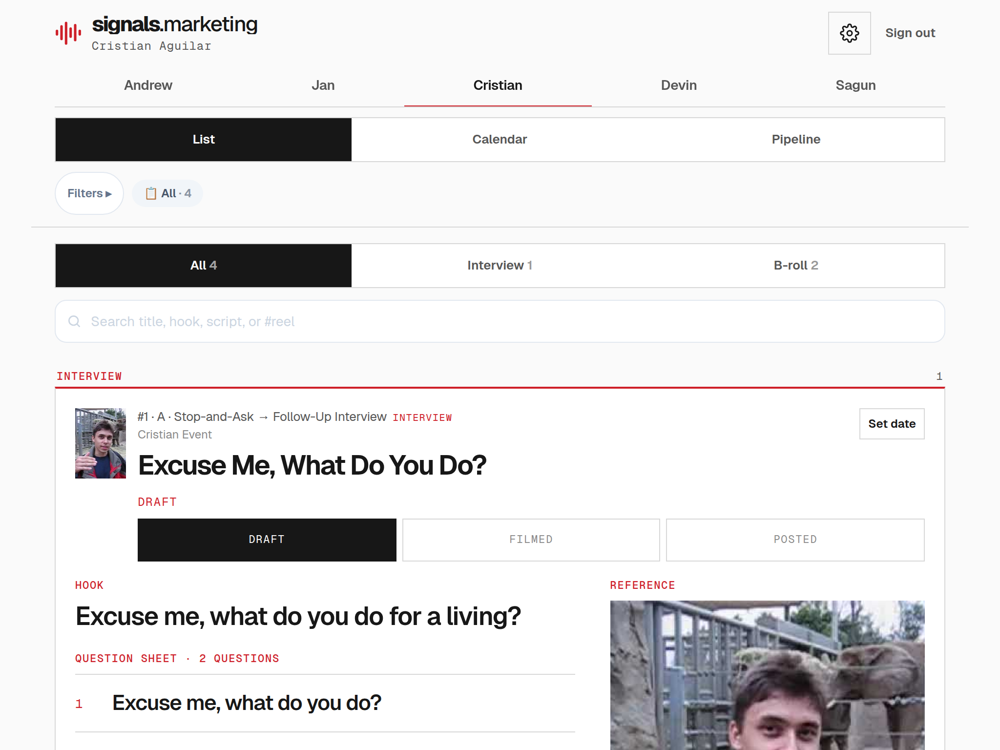

### 1280px

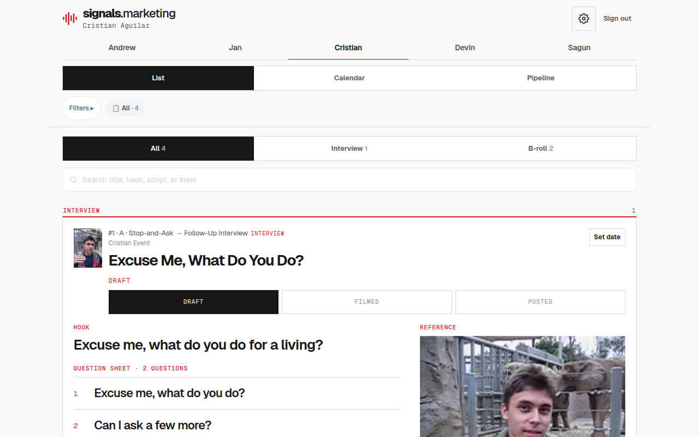

### 1440px

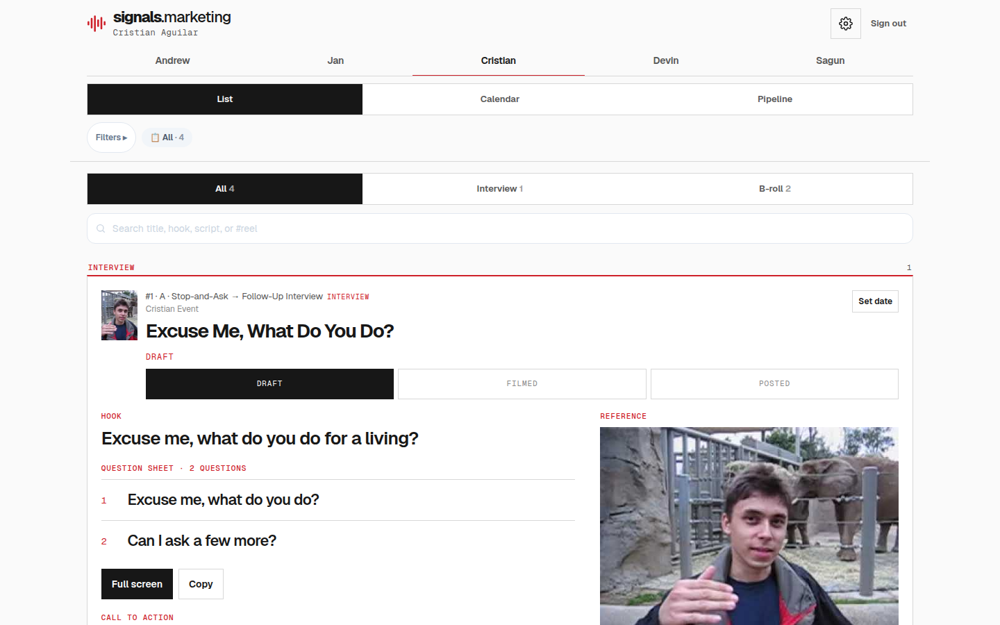

### 1920px

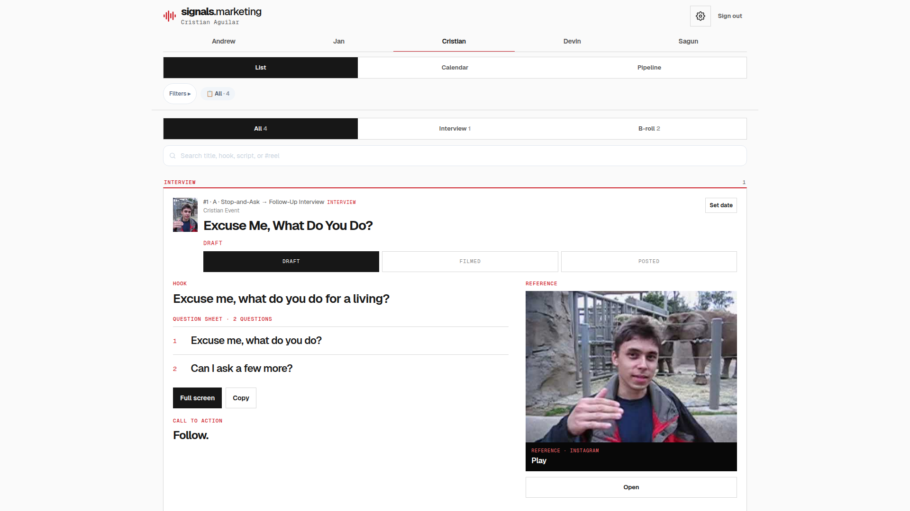

### Calendar and Pipeline at 360px

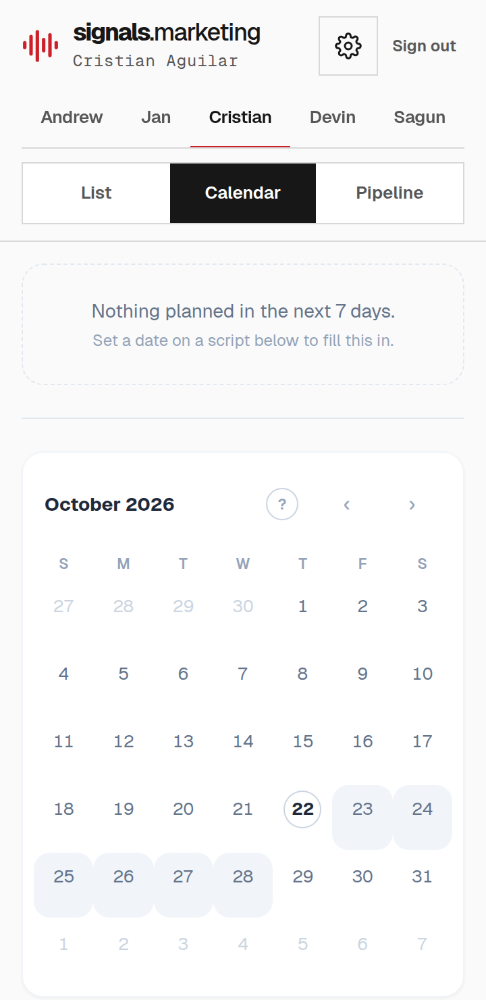

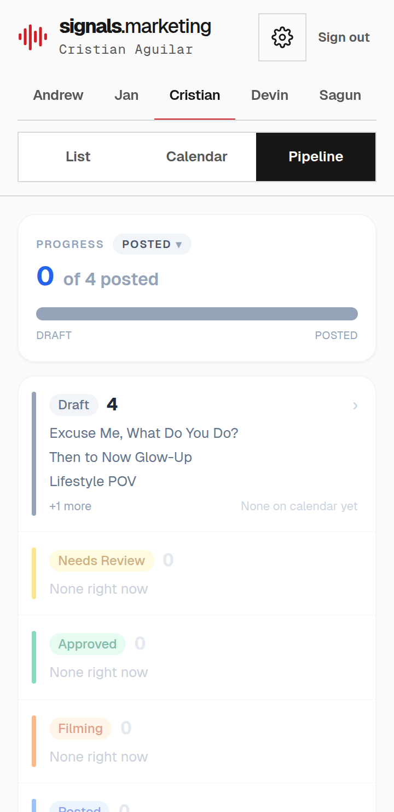
